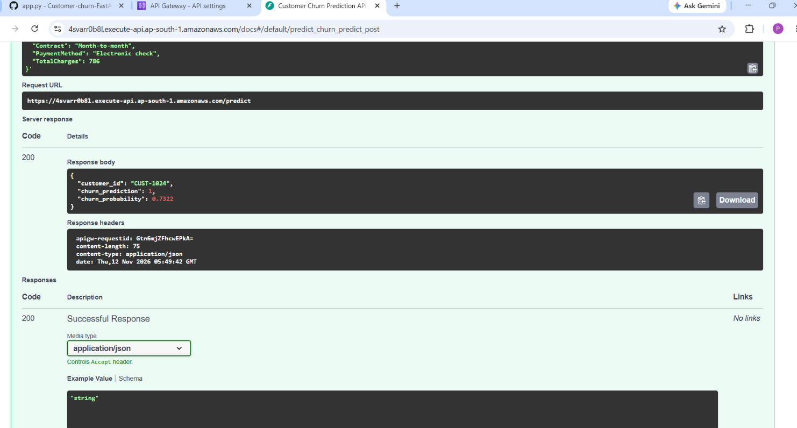

# 🚀 Customer Churn Prediction Serverless API

An end-to-end Machine Learning pipeline and RESTful API built with **FastAPI** and **TensorFlow/Keras** to predict customer churn based on demographic and subscription attributes, deployed via **AWS Lambda** and **Docker**.

## 📌 Project Overview
This repository contains a deployed Artificial Neural Network (ANN) model served via a high-performance FastAPI backend. It features robust request validation with Pydantic, one-hot feature encoding, and serverless deployment via AWS Lambda and Amazon ECR.

## 🛠️ Tech Stack
* **Framework:** FastAPI, Uvicorn, Mangum (AWS Lambda ASGI adapter)
* **Machine Learning / Deep Learning:** TensorFlow / Keras (Sequential API), Pandas, NumPy, Scikit-Learn
* **Data Validation:** Pydantic
* **Cloud & DevOps:** AWS Lambda, Amazon API Gateway, Amazon ECR, Docker

## 📂 Project Structure
```text
.
├── app.py              # Core FastAPI application & predict endpoint
├── churn_model.keras   # Trained ANN model artifact
├── dockerfile          # Container configuration for AWS Lambda
├── requirements.txt    # Python dependencies list
└── README.md           # Project documentation
📌 API Endpoints
GET /: Health check and model loading status (model_loaded: true/false).

POST /predict: Accepts customer demographic and account metrics to return a real-time churn prediction score and probability.
📦 Request Example (/predict)
{
  "CustomerID": "CUST-1024",
  "Age": 35,
  "Gender": "Male",
  "Tenure": 12,
  "MonthlyCharges": 65.50,
  "Contract": "Month-to-month",
  "PaymentMethod": "Electronic check",
  "TotalCharges": 786.00
}
## 📸 API Preview / Output
